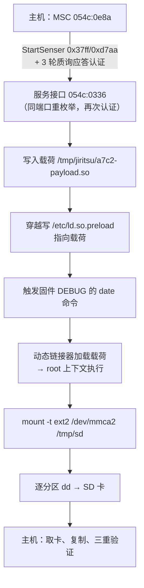

# Sony ILCE-7CM2（A7C II）整机固件转储 —— 方法、脚本与结论

> 日期：2026-10-16 ｜ 目标：ILCE-7CM2（A7C II，固件 2.01）
> 授权范围：**仅限设备所有者本人的这台相机**，用于授权学术研究
> 本文不含转储产物本身：读者按"思路 → 脚本"即可在自己设备上得到同样的结果

---

## 摘要

| 问题 | 结论 |
|---|---|
| 能否在不修改固件、不砖机的前提下取得相机内 root？ | **能**。经"预加载 + 固件 DEBUG 触发点"路径，真机取得 `uid=0 euid=0 gid=0 egid=0`（以 `/proc` 证据判定，非提示符） |
| 能否完整转储整机固件？ | **能**。一次会话把 **19 个分区 / 1.80 GiB** 完整写入 SD 卡，含全部明文分区 |
| 转储结果可信吗？ | 三重独立验证：`e2fsck` 结构干净；52 个文件与另一条通路（服务通道读）逐一 SHA-256 一致；与本地厂商参照树全树比对 **1079 个文件 1078 个逐字节一致**（唯一差异已定位为参照树自身被替换） |
| 有现成脚本吗？ | 有。`analysis/dump_system.py` 一条命令跑完"检查 → 转储 → 取回 → 验证" |

**最容易踩的坑（本文最重要的结论）**：相机内部闪存每个分区存在**两个内核设备视图**，读错会得到"看起来成功、实际是密文"的镜像。详见 §2.2。

---

## 1. 思路

### 1.1 为什么不能直接读闪存

固件签名链完整、rootfs 只读、服务接口只提供受限命令 —— 因此分三步走：

1. **先拿到任意文件读**：服务模式下逐个读取文件，与本地更新包镜像比对，确认读通路真实（52 个文件、约 107 MB 全部 SHA-256 一致）；
2. **再拿到 root 代码执行**：固件 DEBUG 路径存在硬编码命令
   `fork + execv("/bin/sh","-c","/bin/date -s 070421422017.26")`，
   命令内容**无法由参数改变**，所以唯一入口是经动态链接器注入代码：把 `/etc/ld.so.preload` 指向载荷 `.so` → 触发该 fork → 载荷在构造期获得执行。
   载荷随即 `_exit`，阻断 `date`，因此**不改相机时钟**。
   *副作用*：若载荷未能加载，固件仍会执行 `date`，时钟回到 2017-07-04（菜单可改回）。
3. **最后用它做整机转储**：root 上下文里 `mount` SD 卡的 ext2 分区，逐分区 `dd`，由**相机自己**把 1.8 GiB 写到卡上 —— 避免把整个根文件系统走 USB 分块回传。



### 1.2 服务会话的建立条件

会话入口是**海量存储身份** `054c:0e8a`（不是服务身份），两阶段认证缺一不可：

| 阶段 | 动作 | 结果 |
|---|---|---|
| 1 | 对 `054c:0e8a` 发送 `StartSenser`（vendor request `0x37ff/0xd7aa`）+ 3 轮质询应答 | 相机在**同一 USB 端口**重枚举 |
| 2 | 对新出现身份（`054c:0336`，或 `054c:02a9`）再次认证 | 服务命令可用 |

命令帧为 12 字节头 + 载荷（`pFunc`：`0x10`=ProductInfo、`0x40`=AdjustControl、`0x0f`/`0x11`=文件选择/读取）；单次 bulk 传输上限 1 MiB；需跳过边界 ZLP 包。

### 1.3 关键发现：每个分区有"物理/明文"两个视图

`/proc/partitions` 对每个分区列出两个内核块设备（minor 相差 128），`/dev` 里还有应用创建的符号链接：

```
252   1..30   pnflashaN     物理视图（密文载荷）
252 129..158  cnflashaN     同一分区的明文视图（minor = 物理 + 128）
/dev/nflashaN  -> /dev/cnflashaN    ← 应用与 fstab 使用的名字（即明文视图）
/dev/nflasha   -> /dev/pnflasha
```

相机自身 `/proc/mounts` 是决定性证据：

```
/dev/nflasha7  /     ext2 ro,sync,noatime,nodiratime,errors=continue
/dev/nflasha15 /usr  ext2 ro,sync,noatime,nodiratime,errors=continue
```

**误读物理视图的代价**：`dd /dev/pnflasha7` 得到的 16 MiB 数据熵为 **8.000 bits/byte**（密文），偏移 1080 处无 ext2 魔数 `0x53ef`，与经服务通道独立读出的 `/bin/busybox` 内容**零匹配**——即"成功生成了无用的加密镜像"。转储必须用 `cnflasha*`（或 `nflasha*` 符号链接）。

### 1.4 SD 卡必须同时满足两侧需求

| 侧 | 需求 | 事实 |
|---|---|---|
| 相机 UI | FAT/exFAT | 用户态栈是 PrFILE2；实测整卡 FAT32 与 ext2 均被拒（"请检查所连接的设备"） |
| 相机内核 | 可挂载可写、支持大文件 | `4.9.337-scel+`：**无 exfat、无 ext4**，只有 ext2 满足 |

因此布局为 **exFAT（相机侧）+ ext2（转储侧）** 双分区；脚本的 `--format-card` 会一次建好。

---

## 2. 脚本

### 2.1 前置条件

| 项 | 要求 |
|---|---|
| 主机 | Linux（需 `sudo`：USB 设备节点为 root 专属 + loop 挂载 + 卡格式化） |
| Python | 仓库内 venv：`uv pip install --python analysis/.venv/bin/python -r analysis/requirements.txt`（需 `pyusb`、`pycryptodome`） |
| 工具 | `e2fsprogs`、`dosfstools`、`exfatprogs`、`parted`、`lsblk`、`blkid` |
| 卡 | 一张**可清空的** SD 卡（脚本会重建其分区表） |
| 相机 | 固件 2.01，USB 连主机，身份为 `054c:0e8a`，其卷**未被主机挂载** |
| 可选 | 本地参照树（默认为 `analysis/qemu-runtime/analysis/menu-root`）用于内容盘点；不存在时仍会输出文件系统清单 |

### 2.2 一键使用

```bash
cd analysis

# 全流程：检查 → 相机内转储 → 取回 → 验证（中途会提示两次物理操作）
sudo ./.venv/bin/python dump_system.py --card /dev/sda

# 首次使用、或卡不是目标布局时：先重建卡（会清空整张卡）
sudo ./.venv/bin/python dump_system.py --card /dev/sda --format-card
```

执行过程中只需两个物理动作，脚本会明确提示：
1. 把卡插入相机、用 USB 连接相机 → 相机内写入所有明文分区（约 2 GiB，数分钟）；
2. 把卡取出插到主机 → 自动复制并逐镜像校验。

**分阶段续跑**（中断后无需重头来）：

```bash
sudo ./.venv/bin/python dump_system.py --card /dev/sda --stage check   # 只检查前置条件
sudo ./.venv/bin/python dump_system.py --card /dev/sda --stage dump    # 只在相机内转储
sudo ./.venv/bin/python dump_system.py --card /dev/sda --stage fetch   # 只取回镜像
sudo ./.venv/bin/python dump_system.py --card /dev/sda --stage verify  # 只验证并生成清单
```

输出目录默认 `analysis/output/system-dump/`：`*.img`（每个分区一个）、`manifest.json`（含每镜像 SHA-256）、`partition-inventory.json`（文件系统类型 + 内容认领）、`verification.json`（全树比对结果）。

镜像命名：`/` 与 `/usr` 保持语义名 `a7c2-rootfs.img` / `a7c2-usr.img`，其余按分区表逻辑名命名为 `nflashaN.img`（不采用设备节点名 `cnflashaN`，否则验证阶段会因文件名不符而静默跳过这两个分区的校验）。

### 2.3 脚本做什么（内建验证，无需另行判断）

| 阶段 | 动作 | 内建判据 |
|---|---|---|
| `check` | 校验相机身份、卷未挂载、卡布局；`--format-card` 时重建 `1MiB–440GiB` exFAT + `440GiB–100%` ext2 | 不满足即**中止**，不进入设备会话 |
| `dump` | 认证 → 载荷执行 → `mount -t ext2 /dev/mmca2 /tmp/sd` → **自动发现**所有 `cnflasha*` / `nflashaB*` 并逐个 `dd` → 写 `DONE` 标记 → 卸载 | 挂载返回码、`dd` 记录、完成标记三者齐备才算成功；后台与命令管道分离，避免 worker 阻塞 |
| `fetch` | 只读挂载卡的 ext2 分区 → 复制镜像 → **双向 SHA-256** | 大小相同不作为通过依据，必须摘要一致，否则报 `failed` |
| `verify` | `e2fsck -fn` 全部 ext2 镜像；`verify_card_dump.py` 与服务通道独立读出的文件比对；`verify_system_dump.py` 全树比对；`identify_partition_images.py` 识别每个镜像 | 任一项不一致则以非零码退出并写明差异文件；**已声明的参照树差异**（见 `ALLOWED_DIFFERENCES`）仍会打印但不判失败——判断依据是转储本身，而非参照树的状态 |
| 收尾 | 写 `manifest.json`（19 镜像的 SHA-256） | — |

### 2.4 脚本组成

| 文件 | 职责 |
|---|---|
| `analysis/dump_system.py` | 编排：四阶段、物理操作提示、清单产出 |
| `analysis/usb_service_probe.py` | 服务会话、载荷部署、`--dump-to-card` 驱动 |
| `analysis/jiritsu_card_dump.py` | 相机内挂载 + 分区自动发现 + `dd` + 完成标记 + 卸载 |
| `analysis/copy_card_images.py` | 取回并双向校验 |
| `analysis/verify_card_dump.py` | 镜像内文件与独立读出的摘要比对（`debugfs` 直读，无需 root） |
| `analysis/verify_system_dump.py` | `/`+`/usr` 合并后与参照树全树比对（loop 只读挂载） |
| `analysis/identify_partition_images.py` | 每镜像的文件系统类型与内容认领 |
| `analysis/rootterm_verify.py` | 旁支验证：Senser 终端通路（判据为 `Uid/Gid`，见 §3.4） |
| `analysis/run_command.py` | 任意命令执行：一次会话内多命令 / 批量 / 交互；`--shell` 进入常驻终端（保留 `cd`/`export`），结果含每条退出码 |

**依赖（这些脚本不是开箱即用的）**：`usb_service_probe.py` 需要 vendored 第三方 `Sony-PMCA-RE` 放在
`scripts/vendor/pmca-adamwuqwq/`（本报告所用 revision `3824c398c0fa`），以及 Python 包
`pyusb`、`pycryptodomex`；载荷 `.arm64.so` 的校验值与源码见仓库 `payload/`；
`verify_system_dump.py` / `identify_partition_images.py` 另需一份与相机同版本的厂商文件树作为参照
（可用官方更新包 + `fwtool.py` 解出）。完整依赖表见仓库 `README.md`。

---

## 3. 结论

### 3.1 已完成并验证的能力

| 能力 | 判据 |
|---|---|
| 服务模式任意文件读 | 52 个文件（约 107 MB，含 `appFw.so` 99,960,744 B）与本地镜像 SHA-256 全一致 |
| 相机内 root 执行 | `/proc/$$/status` 报 `Uid: 0 0 0 0`、`Gid: 0 0 0 0`；`/dev/nflasha7` 16,777,216 B、`nflasha15` 807,403,520 B 可读 |
| 常驻命令通道 | nonce 防陈旧输出、退出令牌确认 worker 停止、预加载按**读回内容**中和 |
| 写入能力 | Work 区 1 KiB；SD 卡 1 KiB（主机直读卡三方一致）；穿越写 `/etc/...` 256 B |
| 整机转储 | 19 个镜像，`dd` 均报 `N+0 records out`（`nflasha1` 为 `23+1`，非 1 MiB 整数倍） |

### 3.2 转储产物构成（19 个分区）

| 镜像 | 大小 | 文件系统 | 身份 |
|---|---:|---|---|
| `a7c2-rootfs.img` | 16 MiB | ext2 | `/`（5100×1024 B，1280 inode，clean） |
| `a7c2-usr.img` | 770 MiB | ext2 | `/usr`（751980×1024 B，187680 inode，clean） |
| `nflasha2/3/8/10/11/12/13/18/22/30` | 4–75 MiB | vfat | `/setting`、`/system`、`/cp`、`/tmp`+`/etc`+`/var`、`/log`、`/cert`、`/lens`、`ai_dict`、`/usr/data/lut` |
| `nflasha1` | 24 MiB | vfat | Updater |
| `nflasha6` | 25 MiB | vfat | Work 区（含研究遗留文件） |
| `nflasha5` | 300 MiB | 裸数据 | `WBI2` 热启动镜像 |
| `nflasha4` | 12 MiB | 裸数据 | MPR 备份，格式未识别 |
| `nflashaB0`/`B1` | 4 MiB / 4 MiB | 裸数据 | `EXBL` 启动槽 / 全零空槽 |
| `nflasha23` | 64 MiB | 裸数据 | 全零，未使用 |

### 3.3 验证结果

| 验证 | 方法 | 结果 |
|---|---|---|
| 结构 | `e2fsck -fn` | 两个 ext2 镜像 clean、无错误 |
| 跨通道内容 | 与经服务通道独立读出并记录 SHA-256 的文件比对 | rootfs **49/49**、`/usr` **3/3** 一致 |
| 全树 | 挂载镜像与本地厂商参照树逐文件比对 | 比对 **1079**，逐字节一致 **1078** |
| 传输 | 卡 → 主机逐镜像 SHA-256 双向校验 | 19/19 一致 |

**唯一差异 `nflasha`**：`/usr/lib/libIMDB.so` 与本地参照树相差 10 字节（差值恒为 7）。原因不是镜像问题：参照树该文件被 `analysis/qemu-runtime/analysis/prepare-menu-target.py` 替换为研究用插桩版，镜像内那版的 SHA-256 `14f3cd439bf27a68…` 与项目先前记录一致。

### 3.4 旁支结论：未改固件无法直接开启 root 终端

厂商 PMCA 库提供 `setTerminalEnable()` / `readTerminal()` / `writeTerminal()`（Senser TE 通道），本项目此前 6 次服务会话从未实际发送过终端启用命令。本次真机验证：

1. 两阶段认证成功（`054c:0336` 就绪）；
2. 终端启用命令 `ProductInfo TERM_CHANGE(0x00f1)=1` 被接受（返回码符合要求）；`AdjustControl 0x601/0x1f` 的返回值被上游库以 `try/except` 包裹，**本次未能判定**；
3. 终端读写返回 **0 字节**（usbfs 与库内两条通道均为 0）。

**方法学修正**：事后读 `054c:0336` 描述符发现该接口只有 4 个端点 `0x81/0x02/0x83/0x04`，**不存在 `0x01`** —— 上游 PMCA 的 `writeTerminal(ep=1)` 对本机型是错的，首次尝试的写方向从未送达相机。因此该否定结论限定为：*按 PMCA 记录的端点写法无法取得终端*；`0x83/0x04` 端点对尚未验证（`analysis/rootterm_verify.py` 已支持两对端点轮试）。若继续此方向，建议先验证该端点对，或走"固件侧挂 ldisc + 预生成 shell"的方案（`analysis/output/rootsh-v2/`）。

### 3.5 判读纪律（避免"看起来成功"）

- **不要用提示符判断权限**：只看 `/proc/$$/status` 的 `Uid`/`Gid`；
- **不要用"命令返回 0"判断有效**：`dd` 成功不证明内容有意义，必须做文件系统级校验（`e2fsck`、魔数、熵）；
- **不要用单一证据判断完整**：结构 + 跨通道摘要 + 全树比对，三者缺一不可。

---

## 3.6 恢复经验（实测记录）

本轮研究过程中触发过一次"预加载状态不可确认"的恢复场景（成因是**相机内部 12 MiB 分区被写满**：
`/tmp`、`/etc`、`/var` 同属该分区，写满后连中和 `/etc/ld.so.preload` 的清理写入都会失败）。
完整的因果链、固件写入语义（覆写会截断、可创建、0 字节文件也可写）、以及五步恢复流程，
见仓库文档 [`RECOVERY-AND-LESSONS.md`](https://github.com/chocotan/a7c2-re/blob/main/report/2026-10-16-system-dump/RECOVERY-AND-LESSONS.md)。

**由此确立的规则**：批量数据（镜像、内存转储、dd 输出）一律写 SD 卡；相机侧只保留千字节量级文件。

## 4. 遗留问题

| 项 | 说明 |
|---|---|
| `nflasha4`（12 MiB） | 无文件系统特征、开头为随机字节，格式未识别（MPR 备份区） |
| `nflasha5`（300 MiB） | `WBI2` 热启动镜像，未解析内部结构 |
| `nflasha1/13/18/22/23/B0/B1` | 本地参照树无对应内容，身份由分区表位置与内容推断 |
| Senser TE 通路 | PMCA 端点写法为否定结论；`0x83/0x04` 未验证 |
| 会话后状态 | 每轮会话后相机停在 `054c:096f`，需手动重连（程序化恢复未实现） |
| 相机 Work 区 | 转储中含研究遗留文件（`a7c2-payload.so` 等），脚本未自动清理 |
| 相机 不认SD 卡 | 在Dump到SD卡后，相机可能无法识别SD卡，请直接拔电池后重启即可恢复（关机无效，请直接拔电池）
---

## 附录 A：Evidence Chain

| E-id | 内容 | 复现命令 / 判据 |
|---|---|---|
| E-01 | 服务模式认证与读通路 | `dump_system.py --stage check` 后 `dump` 阶段的 `events.jsonl`；52 个文件摘要与本地镜像比对 |
| E-02 | root 执行 | 只读探针输出中的 `uid=0 euid=0 gid=0 egid=0`（载荷 `system_dump_probe.arm64.so` = `5a95d422dff2134b055e159f786184b2929553c3416f0a0b8d847aee816bc5f1`） |
| E-03 | 设备双视图 | `--mailbox-command "cat /proc/mounts; ls -l /dev/nflasha* /dev/cnflasha*"` 的输出 |
| E-04 | 整机转储 | 脚本 `dump` 阶段的相机侧 `ls -l` 清单与 `dd` 日志；`worker_stopped=true`、`disarm_method=content-verified` |
| E-05 | 结构与内容验证 | `dump_system.py --stage verify` 输出；`e2fsck -fn` 与 `verification.json` |
| E-06 | 终端通路否定 | `rootterm_verify.py` 的 `result.json` 与 `terminal-raw.bin`（0 字节）；`lsusb -v -d 054c:0336` 的端点表 |

**F（发现）**：F-01 任意文件读、F-02 root 执行、F-03 双视图（读错即得密文）、F-04 整机可完整转储并三重验证、F-05 未改固件无 root 终端、F-06 分区身份（13 明确 / 6 为裸数据或推断）。
**P（路径）**：P-01 服务会话建立（两阶段认证）、P-02 双视图判定、P-03 载荷注入与 DEBUG 触发、P-04 相机内 `dd` → SD 卡 → 主机验证。

## 附录 B：工具与测试

```bash
cd analysis
python3 -m pytest $(ls test_*.py | grep -v remove_dat | grep -v jiritsu_crypto) -q   # 139 passed, 1 skipped, 58 subtests
./.venv/bin/python -m unittest test_rootterm_verify                                  # 8 passed（需 venv 依赖）
```

---

### 声明

所有结论均来自可复现的命令与其原始输出；否定结果（§3.4）同样保留原始证据。**未执行**：未刷写固件、未修改只读分区、未对他人设备操作。

## 附录 C：参考资料

### 直接使用 / 逐字节对照的上游项目

| 项目 | 链接 | 本报告中的用途 | 本地副本（含 revision） |
|---|---|---|---|
| Sony-PMCA-RE（上游） | <https://github.com/ma1co/Sony-PMCA-RE> | 认证框架与 Senser 协议的公开参照（`pmca/usb/sony.py`） | — |
| Sony-PMCA-RE（本报告使用版） | <https://github.com/adamwuqwq/Sony-PMCA-RE> | 终端通路验证与端点布局调查所用的 vendored 副本 | `analysis/vendor/pmca-adamwuqwq/` @ `3824c398c0fa` |
| Sony-PMCA-RE connection patch | <https://github.com/q19032/Sony-PMCA-RE-connection-patch> | 连接与恢复流程对照 | `analysis/reference/Sony-PMCA-RE-connection-patch/` @ `12c971c965ff` |
| fwtool.py | <https://github.com/ma1co/fwtool.py> | 解析固件更新包、取出参照树（`menu-root`）与分区配置 | `analysis/vendor/fwtool/` @ `72fbdd15ddcc` |

### 同机型（ILCE-7CM2 / 固件 2.01）既有工作

两份内容逐字节相同、仅含文档的仓库，记录了同一台相机从服务会话到一次性 root 执行的路径；本报告的思路与其中"Jiritsu 路径 + 动态加载器"部分一致，并由真机结果进一步给出整机转储与三重验证。

| 项目 | 链接 |
|---|---|
| a7c2-service-preload | <https://github.com/YuuLuo/a7c2-service-preload> |
| a7c2-service-preload（镜像副本） | <https://github.com/chocotan/a7c2-service-preload> |

### 相邻机型与相关工作

| 项目 | 链接 | 相关性 |
|---|---|---|
| ILCE-7M4-RE | <https://github.com/DavidBuchanan314/ILCE-7M4-RE> | 同代机型的逆向记录 |
| Sony-ILCE-7M4-Linux | <https://github.com/DavidBuchanan314/Sony-ILCE-7M4-Linux> | 同代机型上运行 Linux 的尝试 |
| sonshell | <https://github.com/goudvuur/sonshell> | Sony 相机 shell 相关工具 |
| Sony-PMCA-RE（另一分支） | <https://github.com/LAK132/Sony-PMCA-RE> | 协议实现的不同分叉，可供交叉核对 |

### 依赖

| 项目 | 链接 | 用途 |
|---|---|---|
| python-sha1 | <https://github.com/ajalt/python-sha1> | PMCA 认证计算中的 SHA-1 实现 |
| pycparser | <https://github.com/eliben/pycparser> | PMCA 依赖 |

> 说明：本报告只把这些项目作为**协议与流程的参照**；所有结论均来自本仓库工具在真机上的输出。上表未列出的第三方组件见 `THIRD_PARTY_NOTICES.md`。
